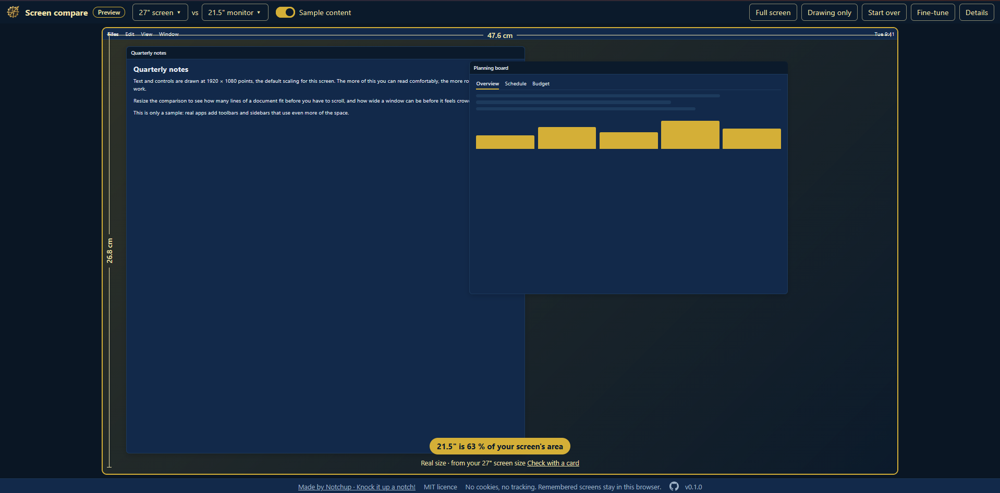

# screen-compare

See any laptop, phone or monitor at its real size, on the screen you are using now. Plain HTML and JavaScript, no build step, no dependencies, no tracking.

**Live page:** https://screen-compare.notchup.fi



Early preview (v0.2). Sizes are worth checking with a ruler; details may still change.

## Why this exists

I needed to know how much smaller a 14 inch laptop screen would look next to my 16 inch one. Spec sheets only give inches, which are hard to picture, and a web page cannot ask the browser how big your screen really is. So this page asks for one number, the size of your screen in inches (or a card or ruler held against it), and draws the other screen at real size on top of yours.

## How to use it

1. Say how big your screen is. A detected laptop only needs a "That's right"; otherwise type the inches, or measure with a card (any bank, ID or loyalty card: they are all the same size).
2. Pick the screen to compare with: sizes of your own kind (phones, tablets, laptops or monitors; "Show all sizes" for the rest), any other size or a specific laptop or phone model. Smaller and bigger screens both work.
3. A gold outline shows it at real size, with its width and height. Hold a ruler to the screen to check, or fine-tune with a card or a ruler. It works on phones and tablets too.

Everything runs in your browser. No cookies, no tracking. Your screens are remembered in this browser only if you ask, and never leave it; so are a dark or light theme and the language (English or Finnish) you pick. A comparison lives in the page's link, so you can share it.

## Run it locally

```sh
./dev serve --open      # needs python3 (or Node.js); PowerShell: .\dev.ps1 serve -Open
./dev check             # tests, plus a check that the page loads
```

Do not open `index.html` straight from disk: browsers block ES modules on `file://`. More commands, how the scale is worked out, how to add a screen preset, releases and deploys are in [docs/how-it-works.md](docs/how-it-works.md).

## Licence

MIT, see [LICENSE](LICENSE). This project does not take issues or pull requests; fork it freely.

## Name and logo

The code is MIT, but the Notchup name, the logo (`assets/mark.svg`) and the share image (`assets/og.png`) are © Notchup Oy, all rights reserved, and are not licensed for reuse. Forks are welcome; please give yours its own name and branding, and remove ours. If you build on this, a small credit like "based on screen-compare by Notchup" is always appreciated.

A fork or modified version is not made, endorsed or supported by Notchup Oy, must not suggest otherwise, and Notchup is not responsible for it or for how it is used.

Made by [Notchup](https://notchup.fi).
